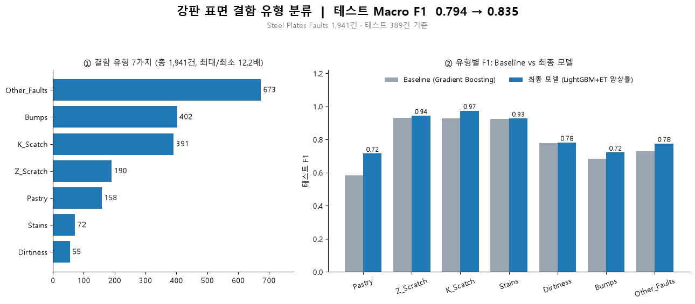
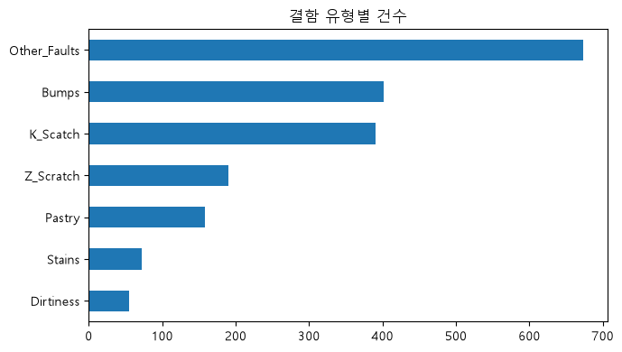
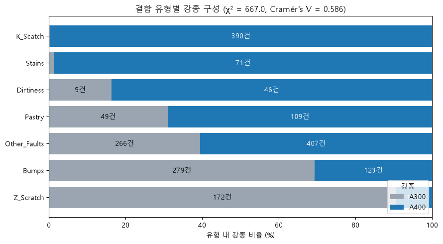
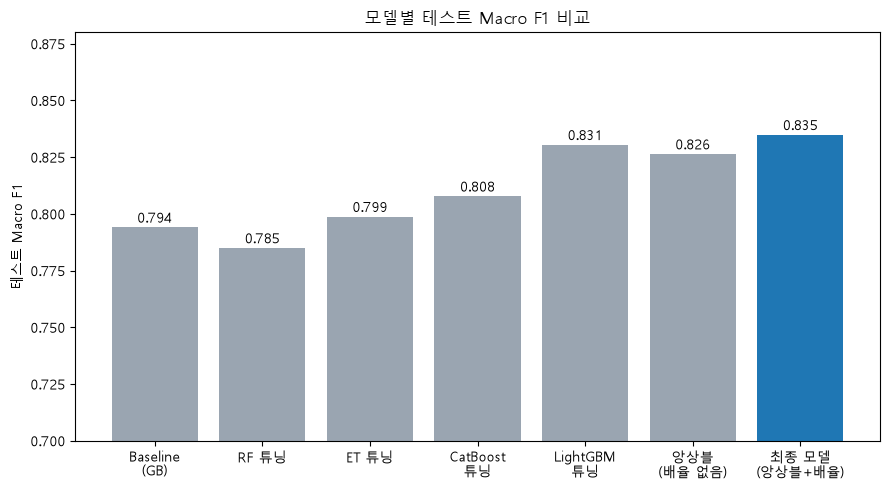
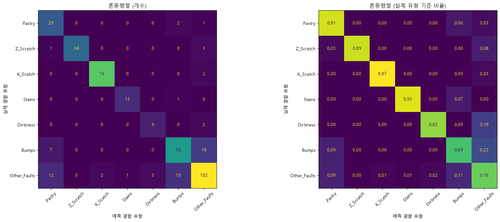
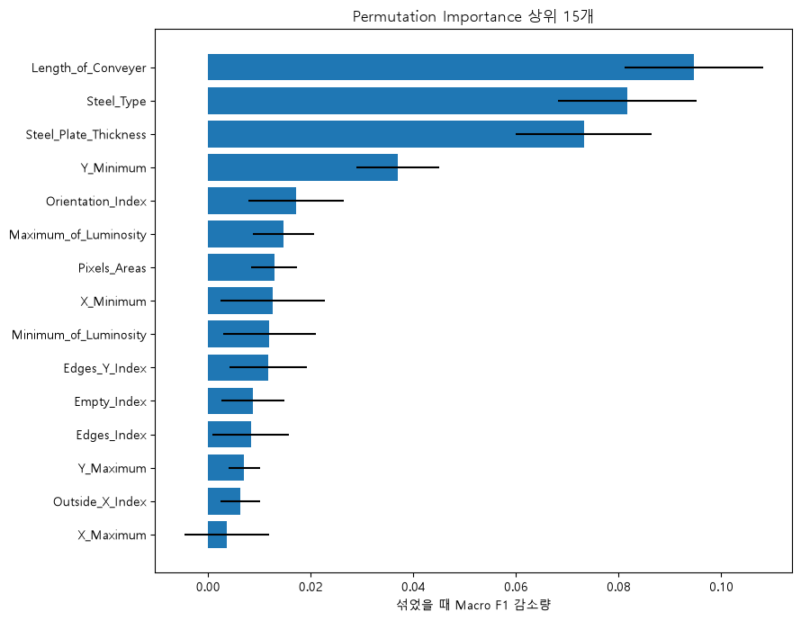
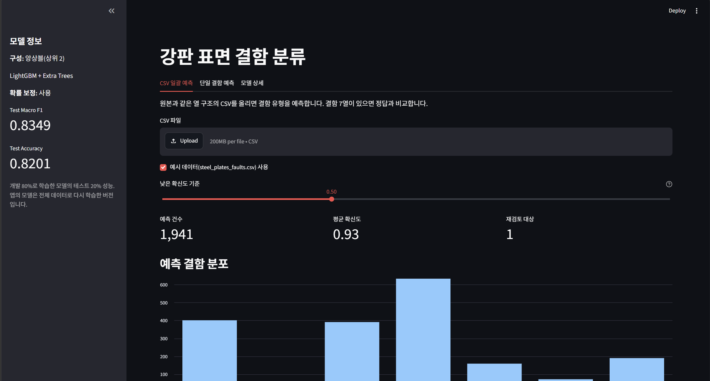

# 프로젝트명

프로젝트에서 해결하고자 하는 문제와 핵심 내용을 한 문장으로 소개합니다.

프로젝트의 배경, 목적, 주요 결과를 2~3문장으로 요약합니다.



---

## 1. 프로젝트 개요

### 1.1 프로젝트 소개

**프로젝트 배경**

- 어떤 문제를 해결하기 위한 프로젝트인지 설명합니다.
- 해당 문제를 머신러닝으로 접근한 이유를 설명합니다.

**프로젝트 목표**

- 예측 대상(Target)과 목표를 정의합니다.
- 프로젝트에서 중요하게 고려한 평가 지표를 설명합니다.
- 불균형 데이터 처리 전후 모델의 성능 차이를 비교합니다.

### 1.2 프로젝트 정보

| 항목 | 내용 |
|---|---|
| 프로젝트 기간 | YYYY.MM.DD ~ YYYY.MM.DD |
| 프로젝트 유형 | 개인 / 팀 프로젝트 |
| 데이터 출처 | [데이터셋 이름](URL) |
| 주요 기술 | Python, Scikit-learn, XGBoost, Imbalanced-learn, Streamlit |

### 1.3 주요 성과

- **모델 성능:** 예) Recall 0.62 → 0.81 개선
- **불균형 처리:** 예) SMOTE 적용 후 소수 클래스 탐지 성능 개선
- **주요 인사이트:** 예) 특정 변수가 예측에 중요한 영향을 미치는 것으로 확인

*실제 실험 결과를 바탕으로 작성합니다.*

---

## 2. 프로젝트 구조

실제 프로젝트 디렉터리 구조에 맞게 수정합니다.

```text
project/
├── README.md
├── pyproject.toml
├── uv.lock
├── .python-version
├── .gitignore
│
├── data/
│   └── raw/
│
├── notebooks/
│   ├── 01_eda.ipynb
│   ├── 02_preprocessing.ipynb
│   └── 03_modeling.ipynb
│
├── models/
│   └── best_model.pkl
│
├── figures/
│   ├── overview.png
│   ├── target_distribution.png
│   ├── eda_result.png
│   ├── model_comparison.png
│   ├── confusion_matrix.png
│   ├── feature_importance.png
│   └── dashboard.png
│
└── app.py
```

**주요 디렉터리 및 파일 설명**

| 파일 / 디렉터리 | 설명 |
|---|---|
| `pyproject.toml` | 프로젝트 의존성 및 설정 |
| `uv.lock` | 의존성 버전 고정 |
| `data/` | 분석에 사용되는 데이터 |
| `notebooks/` | 데이터 분석 및 머신러닝 실험 코드 |
| `models/` | 학습된 모델 저장 |
| `figures/` | 분석 결과 및 시각화 이미지 |
| `app.py` | Streamlit 대시보드 |

*실제 사용하는 파일과 디렉터리만 작성합니다.*

---

## 3. 설치 및 실행 방법

본 프로젝트는 **uv + Jupyter Notebook** 환경을 기반으로 수행되었습니다.

### 3.1 실행 환경

- Python 3.x (실제 사용 버전 명시)
- uv
- Jupyter Notebook 또는 VS Code
- Streamlit

### 3.2 Repository 다운로드

GitHub Repository의 HTTPS 주소를 사용합니다.

```bash
git clone <repository-url>
cd <repository-name>
```

### 3.3 uv 설치 및 환경 구성

먼저 [uv 공식 설치 안내](https://docs.astral.sh/uv/getting-started/installation/)를 참고하여 uv를 설치합니다.

`pyproject.toml`과 `uv.lock`에 정의된 프로젝트 의존성을 설치합니다.

```bash
uv sync
```

프로젝트 의존성에는 Notebook 실행에 필요한 `ipykernel` 등이 포함되어 있어야 합니다.

### 3.4 데이터 준비

데이터가 Repository에 포함되지 않은 경우 아래 방법으로 준비합니다.

1. [데이터셋 다운로드](URL)
2. 다운로드한 데이터를 `data/raw/` 디렉터리에 저장
3. Notebook에서 데이터를 불러와 분석 진행

실제 데이터 파일명과 저장 위치를 명시합니다.

### 3.5 Jupyter Notebook 실행

**VS Code 사용 시**

1. VS Code에서 프로젝트 폴더를 엽니다.
2. 실행할 `.ipynb` 파일을 엽니다.
3. 우측 상단의 **Select Kernel**을 클릭합니다.
4. 프로젝트의 `.venv`에 있는 Python 환경을 선택합니다.
5. Notebook 셀을 순서대로 실행합니다.

### 3.6 분석 및 모델링 실행 순서

| 순서 | 파일 | 주요 내용 |
|---|---|---|
| 1 | `notebooks/01_eda.ipynb` | 데이터 탐색 및 EDA |
| 2 | `notebooks/02_preprocessing.ipynb` | 데이터 전처리 |
| 3 | `notebooks/03_modeling.ipynb` | 모델 학습 및 평가 |

*실제 Notebook 파일명과 실행 순서에 맞게 수정합니다.*

### 3.7 Streamlit 실행

Notebook을 통해 필요한 모델 및 결과 파일을 준비한 후 다음 명령어를 실행합니다.

```bash
uv run streamlit run app.py
```

실행 후 브라우저에서 아래 주소로 접속합니다.

`http://localhost:8501`

별도 웹 배포 없이 로컬 환경에서 실행할 수 있습니다.

---

## 4. 기술 스택

| 구분 | 사용 기술 |
|---|---|
| Language | Python |
| Environment & Package Management | uv |
| Data Processing | Pandas, NumPy |
| Visualization | Matplotlib |
| Machine Learning | Scikit-learn, XGBoost |
| Imbalanced Learning | Imbalanced-learn |
| Model Interpretation | SHAP |
| Dashboard | Streamlit |
| Development | Jupyter Notebook, VS Code, Git |

*실제 프로젝트에서 사용한 기술만 남깁니다.*

---

## 5. 데이터셋

### 5.1 데이터 개요

**데이터 출처:** [데이터셋 이름](URL)

| 항목 | 내용 |
|---|---|
| 데이터 수 | |
| Feature 수 | |
| Target 변수 | |
| 문제 유형 | 이진 분류 |
| 클래스 비율 | |

### 5.2 데이터 특징

- 주요 Feature와 데이터 특성
- Target 클래스 분포
- 분석 시 고려해야 할 데이터 특성

**Target 클래스 분포**



불균형 데이터의 특징과 모델링에서 고려해야 할 사항을 설명합니다.

---

## 6. 데이터 분석 및 전처리

### 6.1 탐색적 데이터 분석 (EDA)

**주요 분석 내용**

- 데이터 구조 및 변수 유형 확인
- 결측치 및 중복 데이터 확인
- 주요 변수의 분포 확인
- Target 클래스 분포 분석
- 변수 간 관계 분석

**주요 발견 사항**

1. 발견 사항 및 해석
2. 발견 사항 및 해석
3. 발견 사항 및 해석

**분석 결과 시각화**



### 6.2 데이터 전처리

| 처리 항목 | 적용 방법 | 선택 이유 |
|---|---|---|
| 결측치 처리 | | |
| 이상치 처리 | | |
| 범주형 인코딩 | | |
| 스케일링 | | |
| Feature Engineering | | |

**전처리 과정에서 고려한 사항**

- Train / Validation / Test 데이터 분할 방법
- 데이터 누수(Data Leakage) 방지 방법
- 주요 전처리 방법을 선택한 이유

---

## 7. 머신러닝 모델링

### 7.1 Baseline 모델

**사용 모델:** 모델명

**선택 이유**

- Baseline으로 해당 모델을 선택한 이유
- 기본 모델 성능 및 개선이 필요한 부분

### 7.2 모델 비교 및 성능 개선

**적용한 모델**

- 모델 1
- 모델 2
- 모델 3

**주요 실험**

- Baseline 모델 학습
- 다양한 머신러닝 모델 비교
- 불균형 데이터 처리
- 하이퍼파라미터 튜닝

### 7.3 불균형 데이터 처리

**적용한 방법**

- 처리 방법 1
- 처리 방법 2

**선택 이유**

각 불균형 처리 방법을 선택한 배경과 기대 효과를 작성합니다.

**실험 시 고려 사항**

- Resampling 등의 불균형 처리는 학습 데이터에만 적용
- 동일한 평가 데이터에서 처리 전후 성능 비교
- 소수 클래스의 Precision, Recall, F1-score 등 비교

### 7.4 모델 성능 비교

| 모델 / 실험 | Precision | Recall | F1-score | PR-AUC |
|---|---|---|---|---|
| Baseline | | | | |
| 모델 A | | | | |
| 모델 A + 불균형 처리 | | | | |
| 모델 B + 불균형 처리 | | | | |
| 최종 모델 | | | | |

*프로젝트 목적에 적합한 평가 지표를 사용합니다.*

**성능 비교 결과**



**주요 분석 결과**

- 성능이 가장 우수했던 모델:
- 불균형 데이터 처리 전후 성능 변화:
- 모델별 성능 차이가 발생한 원인에 대한 해석:

---

## 8. 최종 모델 및 결과 분석

### 8.1 최종 모델 선정

- **최종 모델:**
- **적용한 불균형 처리 방법:**
- **주요 하이퍼파라미터:**
- **선정 이유:**

### 8.2 최종 모델 평가

**Confusion Matrix**



**평가 결과 해석**

- False Positive 및 False Negative 분석
- 실제 문제에서 중요하게 고려해야 할 오류
- 최종 모델의 강점과 한계

### 8.3 Feature Importance 및 모델 해석



**주요 분석 결과**

- 예측에 중요한 영향을 미친 Feature
- 해당 Feature의 영향에 대한 해석
- 분석 결과를 통해 도출한 인사이트

SHAP을 활용한 경우 해당 시각화와 분석 결과를 추가합니다.

---

## 9. Streamlit 대시보드

머신러닝 프로젝트의 주요 분석 결과와 모델 성능을 확인하기 위한 Streamlit 대시보드입니다.

### 9.1 주요 기능

- 데이터 및 Target 클래스 분포 시각화
- 불균형 처리 전후 모델 성능 비교
- 최종 모델 평가 결과 확인

### 9.2 실행 화면



*실제 Streamlit 실행 화면을 캡처하여 첨부합니다.*

---

## 10. 결론 및 회고

### 10.1 프로젝트 주요 결과

- 프로젝트 목표 달성 여부
- 최종 모델의 성능 및 주요 개선 사항
- 불균형 데이터 처리 과정에서 확인한 결과
- 분석을 통해 도출한 주요 인사이트

### 10.2 한계점 및 개선 방향

- 데이터 측면의 한계
- 모델 성능 및 일반화 측면의 한계
- 추가로 시도하고 싶은 실험이나 개선 방법

### 10.3 프로젝트를 통해 배운 점

- 데이터 분석 및 모델링 과정에서 새롭게 이해한 내용
- 프로젝트 진행 중 발생한 문제와 해결 경험
- 향후 유사한 프로젝트에서 개선하고 싶은 점

---

## 11. 팀원 및 역할 (팀 프로젝트인 경우)

| 이름 | 담당 내용 | GitHub |
|---|---|---|
| 팀원 1 | | |
| 팀원 2 | | |
| 팀원 3 | | |

팀 프로젝트인 경우 각 팀원의 주요 기여 내용을 작성합니다.